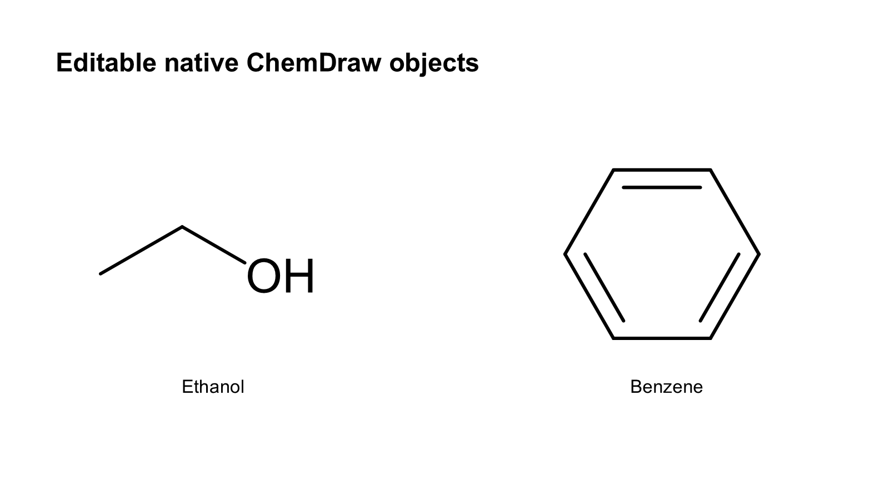

# ChemDraw Native PPT



**Turn chemical figures into editable PowerPoint—not screenshots.**

`chemdraw-native-ppt` is a Codex skill for reconstructing chemical literature figures as editable PowerPoint slides. Molecules remain genuine **native ChemDraw objects**; text, arrows, labels, and simple graphics remain editable PowerPoint objects.

## Install in Codex

Run this single command in a terminal:

```powershell
npx skills add LHH90538/chemdraw-native-ppt --skill chemdraw-native-ppt -g -y
```

Then restart Codex and ask:

> Use `$chemdraw-native-ppt` to convert this chemical figure into an editable PowerPoint. Preserve the molecular structures, special bonds, labels, arrows, and layout, and deliver the PPTX plus the reproducible project.

## What it delivers

- Editable PowerPoint slides with native ChemDraw OLE objects
- A standalone project with a launcher, source reference, manifest, and build files
- Support for multi-molecule and multi-page reaction schemes
- Evidence-grounded structure reconstruction with explicit uncertainty reporting
- Saved previews and validation information for visual and structural checking

## Why it is different

This skill is a reconstruction workflow, not an end-to-end OCSR model. It helps Codex inspect the source figure, recover each molecular graph, preserve chemical drawing conventions, build the slide, and verify the result. It does not silently invent obscured connectivity or claim that a molecule is correct just because a SMILES string parses.

## Requirements

- Windows
- ChemDraw and Microsoft PowerPoint installed and usable
- Windows PowerShell 5.1+
- Python 3.10+ for project initialization

ChemDraw, PowerPoint, their licenses, and an OCSR service are not bundled.

## Run the included example

After installation, ask Codex to run the included example, or use:

```powershell
python scripts/new_project.py --mode example --destination ../chemdraw-demo
powershell.exe -NoProfile -STA -File ../chemdraw-demo/build.ps1
```

The example demonstrates the complete path from a source figure to a PowerPoint containing editable native ChemDraw structures.

## Project references

- [SKILL.md](SKILL.md) — the agent workflow and acceptance criteria
- [Project format](references/project-format.md) — manifest, coordinates, scaling, and outputs
- [Reconstruction guide](references/reconstruction.md) — source inspection and chemistry evidence
- [ChemDraw styling](references/cdxml-style.md) — bond styles, labels, and layout calibration
- [Troubleshooting](references/troubleshooting.md) — common import and Office automation issues

## Privacy and license

The repository contains only code, documentation, and self-authored demonstration assets. Do not commit confidential structures, unpublished figures, personal paths, credentials, or work logs. Your imported literature remains subject to its original copyright and permissions.

Released under the [MIT License](LICENSE). Not affiliated with ChemDraw, Revvity, Microsoft, or OpenAI.
