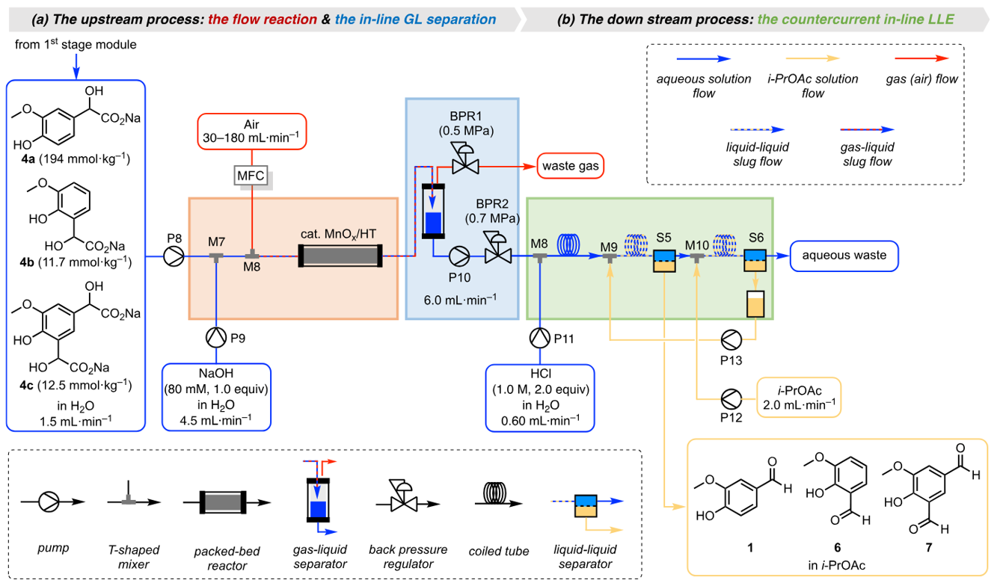

# ChemDraw Native PPT

  
  
  
  
  

<a href="#中文">中文</a> · <a href="#english">English</a>

## 中文

**把化学文献图片变成可编辑的 PowerPoint，而不是截图。**

`chemdraw-native-ppt` 是一个面向 Codex 的专业 skill，用于将化学反应图、合成路线和文献示意图重建为可编辑幻灯片：分子保留为真正的 **ChemDraw 原生对象**，文字、箭头、标签和简单图形保留为可编辑的 PowerPoint 对象。它也支持从已知结构或 SMILES 构造 CDXML，通过 Windows COM 调用 ChemDraw 原生导出，并指导合成 OCSR 数据的自动标注与质量检查。

### 原生分子生成与自动标注

技术路线：**SMILES → 二维布局与CDXML → ChemDraw原生保存／SVG导出 → 图像栅格化与坐标标注**。

- 保留缩写基团的隐藏结构与外接端口，包括经验证的NBz、NBoc、NTs、NMe等环氮双连接缩写。
- 从实际SVG字形读取标签顺序、定位连接原子，并同步完整文字框；已知结构的合成数据无需再用OCR推断真值。
- 处理来源显式氢、重复片段计数、特殊键，以及图像裁切／增强后的坐标变换。
- 按完整字体与绘图样式分批导出；单一ChemDraw控制器配合CPU后处理，采用失败隔离和检查点恢复。

示例请求：

> 使用 `chemdraw-native-ppt`，从这些SMILES生成可编辑CDXML，经ChemDraw原生导出分子图片，并验证实际显示文字与JSON节点、连接和坐标一致。

详见[原生生成与标注技术文档](references/native-generation-and-annotation.md)，内含最小COM导出示例和验证边界。本仓库提供技能指导、PPT项目工具及导出示例，**不附带完整的批量OCSR数据生成引擎**；已有项目应复用并验证自己的实现。

### 安装

直接对 Codex 说：

> 请帮我安装 `chemdraw-native-ppt` 这个 skill。

安装后重启 Codex。使用时说：

> 请使用 `chemdraw-native-ppt` 把这张化学文献图转换成可编辑的 PowerPoint，保留分子结构、特殊键、文字、箭头和原图排版，并交付 PPTX 和可复现项目。

### 能做什么

- 将化学结构重建为可双击编辑的 ChemDraw 对象
- 将文字、箭头、标签和简单图形重建为 PowerPoint 对象
- 支持多分子、多页幻灯片和反应路线图
- 保存源图、项目清单、启动脚本、预览图和验证信息
- 对模糊或遮挡的结构明确标注不确定性，不凭空猜测连接关系

### 环境要求

- Windows
- 已安装并可使用的 ChemDraw；PPT/OLE导出另需 Microsoft PowerPoint
- Windows PowerShell 5.1 或更高版本
- Python 3.10+；Python COM导出示例另需 `pywin32`，SMILES解析／布局可使用RDKit

### 必须安装 ChemDraw 吗？

CDXML文本构造、结构处理和后处理可以在没有ChemDraw的机器上完成。本技能所述的 **ChemDraw原生保存、渲染与回读验证** 需要安装Windows版ChemDraw；最终PPTX/OLE导出还需Microsoft PowerPoint。

仅让 Codex 分析图片、重建结构或准备项目文件时，可以暂时不安装 ChemDraw。但没有 ChemDraw，无法完成原生对象嵌入，也无法保证用户之后能在 PowerPoint 中双击编辑分子。ChemDraw、PowerPoint 及其许可证不包含在本项目中。本项目是“图形重建工作流”，不是端到端 OCSR 模型；复杂结构仍需根据原图进行人工或代理复核。

### 项目文档

- [SKILL.md](SKILL.md)：Codex 的完整工作流程和验收标准
- [项目格式](references/project-format.md)：坐标、缩放、清单和输出
- [重建规范](references/reconstruction.md)：结构识别和证据记录
- [ChemDraw 样式](references/cdxml-style.md)：键型、标签和排版
- [原生生成与自动标注](references/native-generation-and-annotation.md)：COM导出、双连接缩写、实际字形坐标、批量与恢复
- [排错指南](references/troubleshooting.md)：导入和 Office 自动化问题

## English

**Turn chemical literature figures into editable PowerPoint—not screenshots.**

`chemdraw-native-ppt` is a Codex skill for reconstructing chemical reaction schemes, synthesis routes, and literature figures as editable slides. Molecules remain genuine **native ChemDraw objects**, while text, arrows, labels, and simple graphics remain editable PowerPoint objects. It also covers CDXML construction from known graphs or SMILES, native ChemDraw export through Windows COM, and annotation/validation of synthetic OCSR data.

### Native molecular generation and annotation

Workflow: **SMILES → 2D layout and CDXML → native ChemDraw save/SVG export → rasterization and coordinate annotation**.

- Retain hidden chemical definitions and ports, including validated same-N dual-port abbreviations such as NBz, NBoc, NTs, and NMe.
- Read actual SVG glyph order and connection-atom positions; preserve full label boxes and image transformations.
- Keep source-written H, repeat counts, and special-bond semantics synchronized with annotations.
- Batch compatible complete styles, use one native controller, and isolate failed samples with resumable checkpoints.

See [native generation and annotation](references/native-generation-and-annotation.md) for the minimal COM example and validation boundaries. The repository contains skill guidance, PPT project tools, and export examples; it does **not** bundle a complete bulk OCSR dataset engine. Reuse and validate the owning project's implementation when available.

### Install

Simply ask Codex:

> Please install the `chemdraw-native-ppt` skill for me.

Then restart Codex and ask:

> Please use `chemdraw-native-ppt` to convert this chemical literature figure into an editable PowerPoint. Preserve the molecular structures, special bonds, text, arrows, and layout, and deliver both the PPTX and a reproducible project.

### Features

- Native, editable ChemDraw objects embedded in PowerPoint
- Editable PowerPoint text, arrows, labels, and simple graphics
- Multi-molecule, multi-slide, and reaction-scheme support
- Source references, project manifests, launchers, previews, and validation output
- Explicit uncertainty reporting for obscured or ambiguous chemistry

### Requirements

- Windows
- ChemDraw; Microsoft PowerPoint is additionally required for PPT/OLE export
- Windows PowerShell 5.1+
- Python 3.10+; `pywin32` for Python COM export, with RDKit available for SMILES parsing/layout

### Do users need ChemDraw?

CDXML text construction, graph processing, and postprocessing can run without ChemDraw. The **native save, rendering, and readback validation** described here require ChemDraw on Windows. Microsoft PowerPoint is additionally required for PPTX/OLE export.

Codex can analyze a figure, reconstruct structures, and prepare a project without ChemDraw. However, native object embedding and reliable double-click editing in PowerPoint cannot be completed without ChemDraw. ChemDraw, PowerPoint, and their licenses are not bundled. This is a figure-reconstruction workflow, not an end-to-end OCSR model; complex structures still require review against the source figure.

Released under the [MIT License](LICENSE). Not affiliated with ChemDraw, Revvity, Microsoft, or OpenAI.
